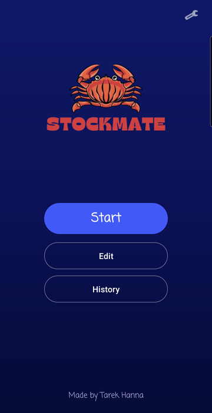
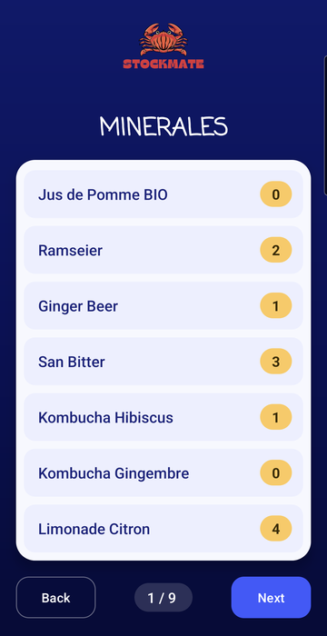
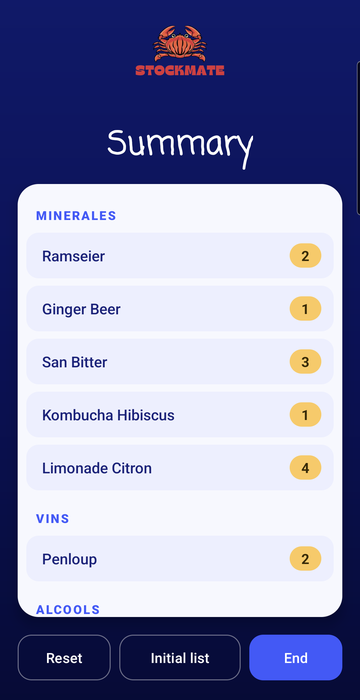
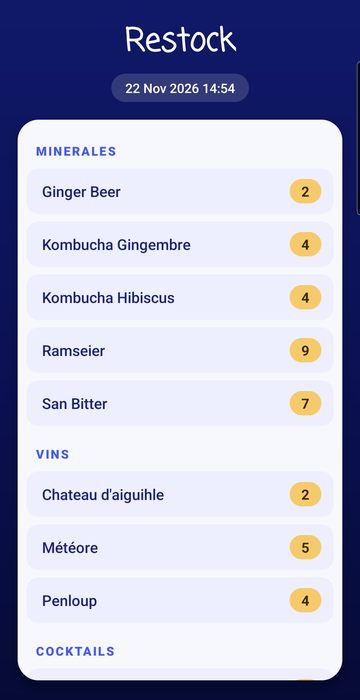

# StockMate

StockMate is an Android app I built in Kotlin to help restaurant employees keep track of inventory and manage restocking. It was my first Android app. I built it for the restaurant where I was working, and my coworkers and I used it there for a few months. The app is not fully built: it covers the core inventory workflow, but it is still a work in progress.

## Why I built it

While working at the restaurant, I saw how much the day depended on drinks and bar supplies being available when staff needed them. Inventory was handled informally, which made it hard to keep track of what was on hand and to notice what needed replenishing before it ran out. I built StockMate to make that work easier to organize from an Android phone.

## How it works

The app covers the bar's products (soft drinks, beers, wines, spirits, cocktail ingredients, syrups, draught beer and coffee supplies), grouped by category. From the main screen, employees choose a task:

1. **Restock.** Go through the categories page by page and tap an item to count how many are needed (long-press to count down). The summary lists everything to bring up, and items can be ticked off one by one while restocking.
2. **Order list.** Go through the categories and check the items that need to be ordered. The summary groups them by category and can be copied in one tap to send to the supplier.
3. **History.** Look back at past restocks and order lists, with the date and the items of each one.

## Screenshots

  
  
  
  

## Built by an employee, for employees

Because I was one of the people doing this work, I designed StockMate around what restaurant staff actually need when they check supplies and handle restocking during a shift. The goal was to make inventory quick to manage from a phone and to help keep important items from being overlooked.

## Project background

StockMate was my first Android app. Building it for my own workplace meant I could watch the app being used every day, hear directly from coworkers, and see what worked and what didn't. That made it a practical introduction to building software for people doing everyday work.

## Project status

StockMate is not finished. The restock, order list and history features work, but some parts are still incomplete:

- The **Edit** button on the main screen does nothing yet.
- The **Settings** screen shows a placeholder profile, and **Manage your account** is not wired up.
- The list of items is written into the app's code, so changing it means updating the app.

## Technology

- **Platform:** Android
- **Language:** Kotlin
- **UI:** Android Views (XML layouts) with Material Components
- **Backend:** Firebase (Cloud Firestore and Firebase Authentication)

## Firebase

StockMate uses Firebase to keep a shared history of the team's work:

- **Cloud Firestore:** each finished restock or order list is saved, and the **History** screen shows past sessions. Saves made offline sync once the phone is back online.
- **Authentication:** the app signs in anonymously in the background, so there's no login screen.
- **Security rules:** only the app can read or add entries, and the history can't be edited or deleted.
